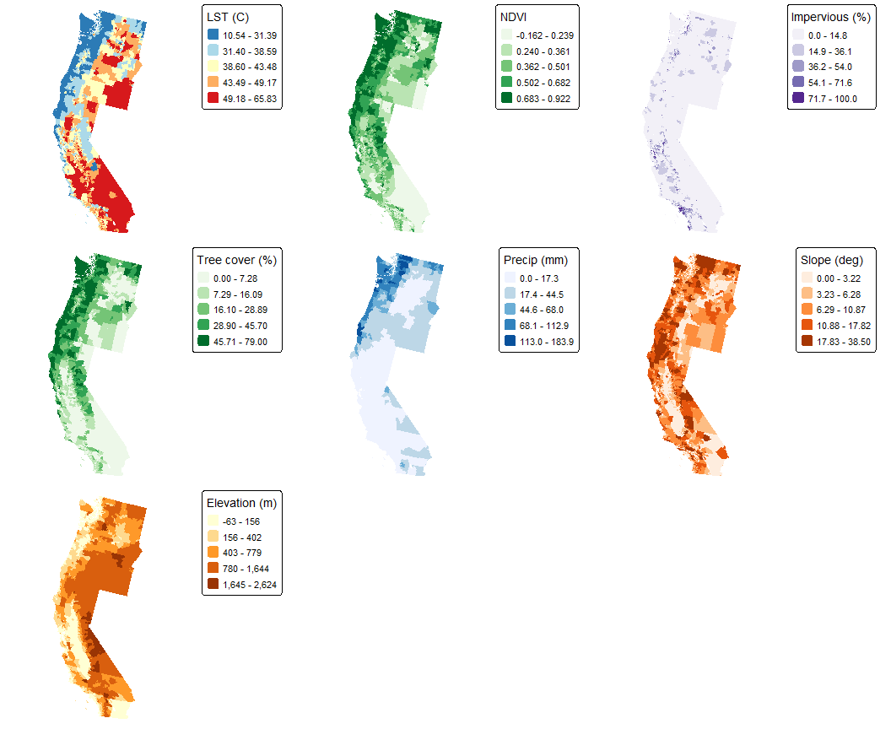
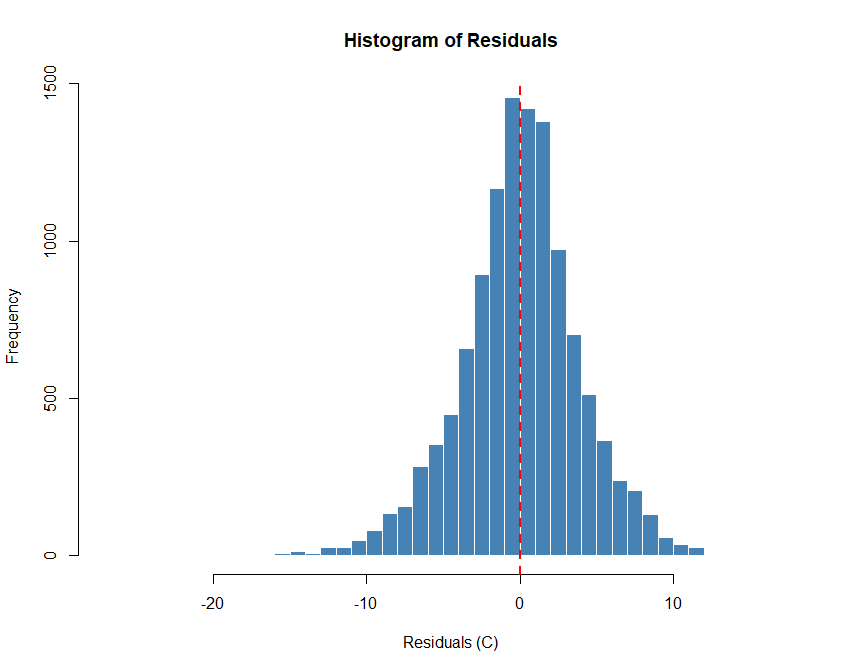
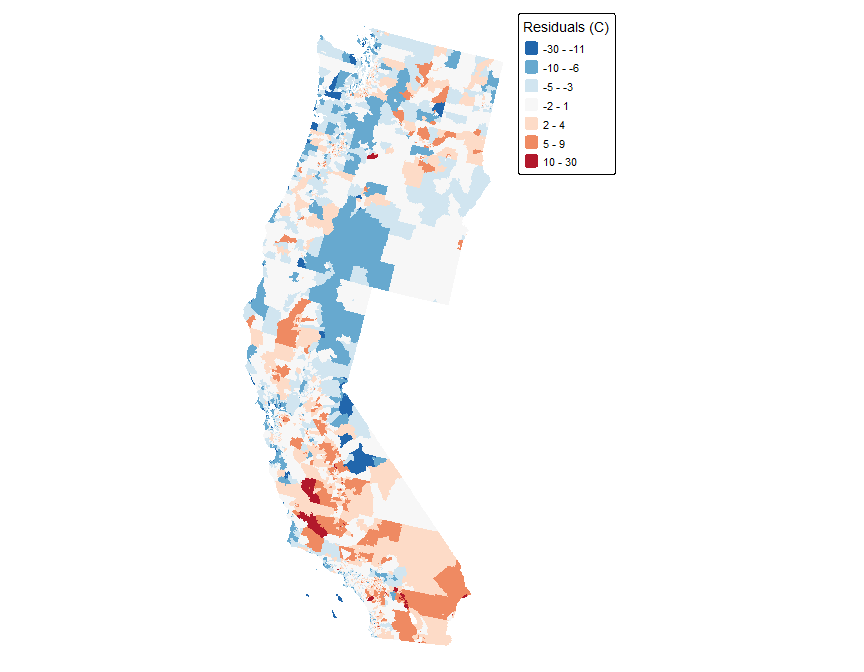
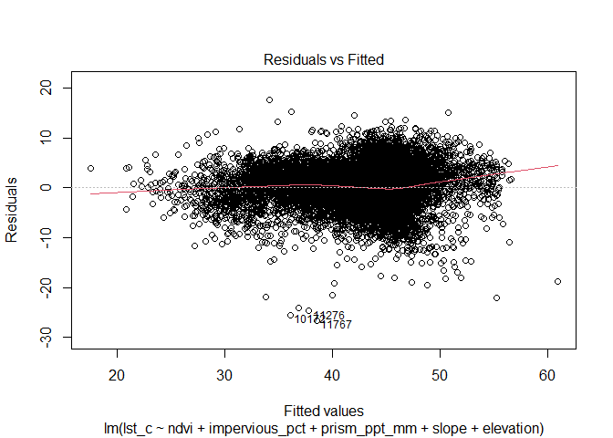

Geog6300: Lab 6
================

## Regression

``` r
library(sf)
library(tidyverse)
library(tmap)
library(corrplot)  
library(car)      
library(lmtest)    
library(sjPlot)    
library(spdep)    
```

**Overview:** This lab focuses on regression techniques. You’ll be
analyzing the association of various land cover, vegetation, climate,
and terrain characteristics with summer land surface temperature (LST)
in tracts across California, Oregon, and Washington. The goal is to
understand which characteristics of places are associated with urban
heat, and how well a linear regression model can explain it.

### Data and research questions

Let’s import the dataset.

``` r
lab6_data<-st_read("data/lab6_gee_lstdata.gpkg")
```

    ## Reading layer `lab6_gee_lstdata' from data source 
    ##   `C:\Users\theop\OneDrive\Documents\GitHub\Geog4-6300-Fall-2026_Lab6_-Emmanuel\data\lab6_gee_lstdata.gpkg' 
    ##   using driver `GPKG'
    ## Simple feature collection with 11837 features and 20 fields
    ## Geometry type: MULTIPOLYGON
    ## Dimension:     XY
    ## Bounding box:  xmin: -2356114 ymin: -364417.2 xmax: -1545551 ymax: 1565791
    ## Projected CRS: USA_Contiguous_Albers_Equal_Area_Conic

The variables in the dataset are:

- GISJOIN: Unique tract identifier from NHGIS (2024)
- lst_c: Land surface temperature (C), the median of clear-sky Landsat
  8/9 observations from June-August 2021. This is the thermal “skin”
  temperature of the surface at the satellite overpass (late morning),
  not air temperature.
- ndvi: Normalized difference vegetation index from Landsat (June-August
  2021 median). Values range from -1 to 1, with higher values indicating
  more vegetation.
- ndbi: Normalized difference built-up index from Landsat (June-August
  2021 median). Higher values indicate more built-up or bare surfaces.
- ndwi: Normalized difference water index from Landsat (June-August 2021
  median). Higher values indicate more water or moisture.
- impervious_pct: Percent of the 30 m pixel covered by impervious
  surface (data from the 2021 National Land Cover Database)
- tree_cover_pct: Percent tree canopy cover (data from MODIS Vegetation
  Continuous Fields, 250 m resolution)
- prism_tmean_c: Mean air temperature (C) from June-August 2021 (data
  from PRISM, 4 km resolution)
- prism_ppt_mm: Total precipitation (mm) from June-August 2021 (data
  from PRISM, 4 km resolution)
- elevation: Elevation in meters (data from the Shuttle Radar Topography
  Mission/NASA)
- slope: Terrain slope in degrees, derived from the elevation data
- nlcd_class/nlcd_label: Land cover class code and label (data from the
  2021 National Land Cover Database)
- developed: 1 if the land cover class at the centroid is one of the
  NLCD developed classes (21-24), 0 otherwise

Our primary research question is how the vegetation, land cover,
climate, and terrain variables in our dataset are predictive of land
surface temperature. Note that the variables come from different sources
at different spatial resolutions, and that the sample is dominated by
developed areas (a large majority of tracts are in developed land cover
classes), so our results speak most directly to urban and suburban heat.

``` r
lab6_data <- lab6_data %>%
  mutate(ndvi_10  = ndvi * 10,            # per 0.1 of NDVI
         imperv10 = impervious_pct / 10,  # per 10 percentage points
         tree10   = tree_cover_pct / 10,  # per 10 percentage points
         ppt10    = prism_ppt_mm / 10,    # per 10 mm of rain
         elev100  = elevation / 100)      # per 100 m
```

### Part 1: Analysis of summer 2021 data

We will start by exploring the distribution of our variables.

**Question 1** *Create histograms for LST, NDVI, impervious surface,
tree cover, precipitation, slope, and elevation. Based on these graphs,
assess the normality of these variables.*

``` r
# Reset graphics
graphics.off()

# Histograms
par(mfrow = c(2, 2), mar = c(3, 3, 2, 1))

hist(lab6_data$lst_c,
     main = "LST",
     xlab = "LST (degrees C)",
     col = "tomato",
     border = "white")

hist(lab6_data$ndvi,
     main = "NDVI",
     xlab = "NDVI",
     col = "forestgreen",
     border = "white")

hist(lab6_data$impervious_pct,
     main = "Impervious Surface",
     xlab = "Percent",
     col = "goldenrod",
     border = "white")

hist(lab6_data$tree_cover_pct,
     main = "Tree Cover",
     xlab = "Percent",
     col = "mediumseagreen",
     border = "white")

par(mfrow = c(2, 2), mar = c(3, 3, 2, 1))

hist(lab6_data$prism_ppt_mm,
     main = "Summer Precipitation",
     xlab = "Millimeters",
     col = "dodgerblue",
     border = "white")

hist(lab6_data$slope,
     main = "Slope",
     xlab = "Degrees",
     col = "mediumpurple",
     border = "white")

hist(lab6_data$elevation,
     main = "Elevation",
     xlab = "Meters",
     col = "darkorange",
     border = "white")

# Reset plotting layout
par(mfrow = c(1, 1))
```

{Based on the histograms, LST is approximately normally distributed,
with a bell-shaped curve and most values around 40 to 50°C. NDVI is
slightly right-skewed, with most values between 0.2 and 0.4. Impervious
surface is not normally distributed: its values cluster near 0% and
again at 50 to 70%. Tree cover, precipitation, slope, and elevation are
all strongly right-skewed. Most observations have low values, and only a
few have very high ones.}

**Question 2** *Use tmap to map these same variables using “fisher” as
the classification method/style. For an extra challenge, use
`tmap_arrange` to plot all maps in a single figure.*

``` r
tmap_mode("plot")

map_lst <- tm_shape(lab6_data) +
  tm_polygons(
    fill = "lst_c",
    fill.scale = tm_scale_intervals(
      style = "fisher",
      values = "-brewer.rd_yl_bu"
    ),
    col_alpha = 0,
    fill.legend = tm_legend(title = "LST (C)")
  ) +
  tm_layout(legend.outside = TRUE, frame = FALSE)

map_ndvi <- tm_shape(lab6_data) +
  tm_polygons(
    fill = "ndvi",
    fill.scale = tm_scale_intervals(
      style = "fisher",
      values = "brewer.greens"
    ),
    col_alpha = 0,
    fill.legend = tm_legend(title = "NDVI")
  ) +
  tm_layout(legend.outside = TRUE, frame = FALSE)

map_imp <- tm_shape(lab6_data) +
  tm_polygons(
    fill = "impervious_pct",
    fill.scale = tm_scale_intervals(
      style = "fisher",
      values = "brewer.purples"
    ),
    col_alpha = 0,
    fill.legend = tm_legend(title = "Impervious (%)")
  ) +
  tm_layout(legend.outside = TRUE, frame = FALSE)

map_tree <- tm_shape(lab6_data) +
  tm_polygons(
    fill = "tree_cover_pct",
    fill.scale = tm_scale_intervals(
      style = "fisher",
      values = "brewer.greens"
    ),
    col_alpha = 0,
    fill.legend = tm_legend(title = "Tree cover (%)")
  ) +
  tm_layout(legend.outside = TRUE, frame = FALSE)

map_ppt <- tm_shape(lab6_data) +
  tm_polygons(
    fill = "prism_ppt_mm",
    fill.scale = tm_scale_intervals(
      style = "fisher",
      values = "brewer.blues"
    ),
    col_alpha = 0,
    fill.legend = tm_legend(title = "Precip (mm)")
  ) +
  tm_layout(legend.outside = TRUE, frame = FALSE)

map_slope <- tm_shape(lab6_data) +
  tm_polygons(
    fill = "slope",
    fill.scale = tm_scale_intervals(
      style = "fisher",
      values = "brewer.oranges",
      midpoint = NA
    ),
    col_alpha = 0,
    fill.legend = tm_legend(title = "Slope (deg)")
  ) +
  tm_layout(legend.outside = TRUE, frame = FALSE)

map_elev <- tm_shape(lab6_data) +
  tm_polygons(
    fill = "elevation",
    fill.scale = tm_scale_intervals(
      style = "fisher",
      values = "brewer.yl_or_br"
    ),
    col_alpha = 0,
    fill.legend = tm_legend(title = "Elevation (m)")
  ) +
  tm_layout(legend.outside = TRUE, frame = FALSE)

tmap_arrange(
  map_lst, map_ndvi, map_imp, map_tree,
  map_ppt, map_slope, map_elev,
  ncol = 3)
```

<!-- -->

**Question 3** *Based on the maps from question 2, summarise major
patterns you see in the spatial distribution of these data from any of
your variables of interest. How do they appear to be associated with the
LST variable?*

{From the maps, I observed that LST follows a clear regional pattern
across the study area. Temperatures generally decrease from south to
north and from inland areas toward the coast. The highest LST values
(49.74–65.83 C) are mainly concentrated in the southern and southeastern
regions, while the lowest values (10.54–31.67 C) are mostly found along
the coast and in the northwestern regions.NDVI, tree cover, and
precipitation show similar spatial patterns that are almost opposite to
the LST pattern. Northern and western regions have more vegetation,
higher tree cover, and greater precipitation, while southern and
southeastern regions are generally drier, less vegetated, and hotter.
This suggests a negative relationship between these variables and LST.
Interestingly, impervious surfaces do not follow the same regional
pattern. Higher percentages of impervious surfaces appear scattered
across urban areas rather than being concentrated in the hottest
regions. Some areas with low percentages of impervious surfaces still
experience high LST. Therefore, the relationship between impervious
surfaces and LST is not very clear from the maps. Slope and elevation
mainly reflect the distribution of mountainous regions. Areas with
steeper slopes generally appear to have lower LST. However, elevation
shows a mixed pattern, as some inland areas with higher elevations also
experience relatively high temperatures. Based on my observations, I
would expect NDVI, tree cover, and precipitation to have strong negative
relationships with LST, slope to have a possible negative relationship,
and impervious surfaces to have a weak relationship. The relationship
between elevation and LST remains unclear. However, further statistical
analysis would be needed to confirm these observations.}

**Question 4** *Create univariate models for each of the variables
listed in question 1, with LST as the dependent variable. Print the
summary of each model. Write a summary of those results that indicates
the direction, magnitude, and significance for each model coefficient.*

``` r
model_ndvi <- lm(lst_c ~ ndvi, data = lab6_data)
model_impervious <- lm(lst_c ~ impervious_pct, data = lab6_data)
model_tree <- lm(lst_c ~ tree_cover_pct, data = lab6_data)
model_ppt <- lm(lst_c ~ prism_ppt_mm, data = lab6_data)
model_slope <- lm(lst_c ~ slope, data = lab6_data)
model_elevation <- lm(lst_c ~ elevation, data = lab6_data)

summary(model_ndvi)
```

    ## 
    ## Call:
    ## lm(formula = lst_c ~ ndvi, data = lab6_data)
    ## 
    ## Residuals:
    ##     Min      1Q  Median      3Q     Max 
    ## -27.058  -2.685  -0.034   2.657  19.114 
    ## 
    ## Coefficients:
    ##              Estimate Std. Error t value Pr(>|t|)    
    ## (Intercept)  51.58466    0.09442   546.3   <2e-16 ***
    ## ndvi        -25.01029    0.24042  -104.0   <2e-16 ***
    ## ---
    ## Signif. codes:  0 '***' 0.001 '**' 0.01 '*' 0.05 '.' 0.1 ' ' 1
    ## 
    ## Residual standard error: 4.56 on 11835 degrees of freedom
    ## Multiple R-squared:  0.4776, Adjusted R-squared:  0.4776 
    ## F-statistic: 1.082e+04 on 1 and 11835 DF,  p-value: < 2.2e-16

``` r
summary(model_impervious)
```

    ## 
    ## Call:
    ## lm(formula = lst_c ~ impervious_pct, data = lab6_data)
    ## 
    ## Residuals:
    ##      Min       1Q   Median       3Q      Max 
    ## -30.4223  -3.6406   0.1517   3.1178  25.4533 
    ## 
    ## Coefficients:
    ##                 Estimate Std. Error t value Pr(>|t|)    
    ## (Intercept)    40.371928   0.113320  356.27   <2e-16 ***
    ## impervious_pct  0.053475   0.002178   24.55   <2e-16 ***
    ## ---
    ## Signif. codes:  0 '***' 0.001 '**' 0.01 '*' 0.05 '.' 0.1 ' ' 1
    ## 
    ## Residual standard error: 6.155 on 11835 degrees of freedom
    ## Multiple R-squared:  0.04848,    Adjusted R-squared:  0.0484 
    ## F-statistic:   603 on 1 and 11835 DF,  p-value: < 2.2e-16

``` r
summary(model_tree)
```

    ## 
    ## Call:
    ## lm(formula = lst_c ~ tree_cover_pct, data = lab6_data)
    ## 
    ## Residuals:
    ##     Min      1Q  Median      3Q     Max 
    ## -31.750  -2.396  -0.131   2.266  20.641 
    ## 
    ## Coefficients:
    ##                 Estimate Std. Error t value Pr(>|t|)    
    ## (Intercept)    47.444158   0.051786   916.2   <2e-16 ***
    ## tree_cover_pct -0.376627   0.002905  -129.7   <2e-16 ***
    ## ---
    ## Signif. codes:  0 '***' 0.001 '**' 0.01 '*' 0.05 '.' 0.1 ' ' 1
    ## 
    ## Residual standard error: 4.056 on 11835 degrees of freedom
    ## Multiple R-squared:  0.5869, Adjusted R-squared:  0.5868 
    ## F-statistic: 1.681e+04 on 1 and 11835 DF,  p-value: < 2.2e-16

``` r
summary(model_ppt)
```

    ## 
    ## Call:
    ## lm(formula = lst_c ~ prism_ppt_mm, data = lab6_data)
    ## 
    ## Residuals:
    ##      Min       1Q   Median       3Q      Max 
    ## -29.0867  -3.0951   0.0335   2.8056  21.8801 
    ## 
    ## Coefficients:
    ##               Estimate Std. Error t value Pr(>|t|)    
    ## (Intercept)  44.809290   0.056561   792.2   <2e-16 ***
    ## prism_ppt_mm -0.149021   0.002117   -70.4   <2e-16 ***
    ## ---
    ## Signif. codes:  0 '***' 0.001 '**' 0.01 '*' 0.05 '.' 0.1 ' ' 1
    ## 
    ## Residual standard error: 5.297 on 11835 degrees of freedom
    ## Multiple R-squared:  0.2952, Adjusted R-squared:  0.2951 
    ## F-statistic:  4956 on 1 and 11835 DF,  p-value: < 2.2e-16

``` r
summary(model_slope)
```

    ## 
    ## Call:
    ## lm(formula = lst_c ~ slope, data = lab6_data)
    ## 
    ## Residuals:
    ##     Min      1Q  Median      3Q     Max 
    ## -32.499  -3.349   0.062   3.197  27.387 
    ## 
    ## Coefficients:
    ##             Estimate Std. Error t value Pr(>|t|)    
    ## (Intercept) 45.30398    0.08062  561.96   <2e-16 ***
    ## slope       -0.56538    0.01341  -42.16   <2e-16 ***
    ## ---
    ## Signif. codes:  0 '***' 0.001 '**' 0.01 '*' 0.05 '.' 0.1 ' ' 1
    ## 
    ## Residual standard error: 5.883 on 11835 degrees of freedom
    ## Multiple R-squared:  0.1306, Adjusted R-squared:  0.1305 
    ## F-statistic:  1778 on 1 and 11835 DF,  p-value: < 2.2e-16

``` r
summary(model_elevation)
```

    ## 
    ## Call:
    ## lm(formula = lst_c ~ elevation, data = lab6_data)
    ## 
    ## Residuals:
    ##     Min      1Q  Median      3Q     Max 
    ## -32.063  -3.293   0.674   3.685  21.434 
    ## 
    ## Coefficients:
    ##              Estimate Std. Error t value Pr(>|t|)    
    ## (Intercept) 4.222e+01  6.933e-02  608.94   <2e-16 ***
    ## elevation   3.035e-03  2.074e-04   14.63   <2e-16 ***
    ## ---
    ## Signif. codes:  0 '***' 0.001 '**' 0.01 '*' 0.05 '.' 0.1 ' ' 1
    ## 
    ## Residual standard error: 6.253 on 11835 degrees of freedom
    ## Multiple R-squared:  0.01777,    Adjusted R-squared:  0.01769 
    ## F-statistic: 214.1 on 1 and 11835 DF,  p-value: < 2.2e-16

{From the regression results, I observed that all six variables have
statistically significant relationships with LST since their p-values
are less than 0.05. However, some variables explain the variation in LST
better than others. Tree cover has the strongest relationship with LST,
explaining about 58.69% of its variation, followed by NDVI, which
explains 47.76%. Both variables have negative coefficients, meaning that
areas with more vegetation and tree cover tend to have lower surface
temperatures. This agrees with what I observed in the maps in Question
3. Precipitation and slope also have negative relationships with LST,
explaining 29.52% and 13.06% of its variation, respectively. This
suggests that wetter areas and areas with steeper slopes tend to have
lower surface temperatures. Impervious surface has a positive
relationship with LST, which is expected because surfaces such as roads
and buildings absorb and retain heat. However, it only explains 4.85% of
the variation in LST, indicating a weak relationship. I found the
elevation result interesting because I expected LST to decrease as
elevation increased. Instead, the results show a weak positive
relationship, explaining only 1.78% of the variation in LST. Tree cover
and NDVI are the best individual predictors of LST, while impervious
surface and elevation are the weakest. Most of these results agree with
my observations from the maps. However, since the variables were
analyzed separately, it would be interesting to see how their
relationships with LST change when they are included together in a
multiple linear regression model.}

**Question 5** *Create a multivariate regression model with the
variables of interest, choosing EITHER NDVI or tree cover (but not
both), since both measure vegetation. You may also choose to leave out
any variables that were insignificant in Q4. Use the univariate models
as your guide. Print the summary of the model.*

``` r
model_all <- lm(lst_c ~ ndvi + impervious_pct + prism_ppt_mm +
                  slope + elevation, data = lab6_data)
summary(model_all)
```

    ## 
    ## Call:
    ## lm(formula = lst_c ~ ndvi + impervious_pct + prism_ppt_mm + slope + 
    ##     elevation, data = lab6_data)
    ## 
    ## Residuals:
    ##      Min       1Q   Median       3Q      Max 
    ## -26.6163  -2.1761   0.1061   2.2683  17.6186 
    ## 
    ## Coefficients:
    ##                  Estimate Std. Error t value Pr(>|t|)    
    ## (Intercept)     5.595e+01  1.959e-01  285.65   <2e-16 ***
    ## ndvi           -2.485e+01  3.428e-01  -72.50   <2e-16 ***
    ## impervious_pct -6.315e-02  2.038e-03  -30.98   <2e-16 ***
    ## prism_ppt_mm   -3.558e-02  2.080e-03  -17.10   <2e-16 ***
    ## slope          -4.219e-01  1.034e-02  -40.80   <2e-16 ***
    ## elevation       4.215e-03  1.517e-04   27.79   <2e-16 ***
    ## ---
    ## Signif. codes:  0 '***' 0.001 '**' 0.01 '*' 0.05 '.' 0.1 ' ' 1
    ## 
    ## Residual standard error: 3.941 on 11831 degrees of freedom
    ## Multiple R-squared:  0.6099, Adjusted R-squared:  0.6098 
    ## F-statistic:  3700 on 5 and 11831 DF,  p-value: < 2.2e-16

**Question 6** *Summarize the results of the multivariate model. What
are the direction, magnitude, and significance of each coefficient? How
did it change from the univariate models you created in Q4 (if at all)?
What do the R2 and F-statistic values tell you about overall model fit?*

{I included NDVI, impervious surface, precipitation, slope, and
elevation in the multivariate model. I excluded tree cover because it is
strongly correlated with NDVI (r = 0.83). All five variables are
statistically significant (p \< 0.001). NDVI has a negative coefficient
of -24.85, meaning that a 0.1-unit increase in NDVI is associated with a
2.49 C decrease in LST. Precipitation and slope also have negative
coefficients of -0.0356 and -0.4219, respectively. Elevation has a
positive coefficient of 0.0042, meaning that a 100 m increase in
elevation is associated with a 0.42 C increase in LST, while holding the
other variables constant. Compared to Question 4, the NDVI coefficient
changed slightly, while the negative coefficients of precipitation and
slope became smaller in magnitude. The positive coefficient of elevation
increased slightly. Interestingly, impervious surface changed from a
positive coefficient of 0.0535 to a negative coefficient of -0.0632.
This may be due to its relationship with other environmental variables
and regional differences. It does not necessarily mean that impervious
surfaces reduce LST. The R-squared value of 0.6099 and adjusted
R-squared value of 0.6098 show that the model explains approximately 61%
of the variation in LST, leaving 39% unexplained. The F-statistic of
3700, with a p-value less than 0.001, indicates that the overall model
is statistically significant and fits the data better than a model
without predictors.}

**Question 7** *Use a histogram and a map to assess the normality of
residuals and any spatial autocorrelation. Summarise any notable
patterns that you see.*

``` r
# Calculate residuals from the multivariate model
lab6_data$residuals <- lab6_data$lst_c - predict(model_all, newdata = lab6_data)

# Histogram of residuals
hist(lab6_data$residuals,
     main = "Histogram of Residuals",
     xlab = "Residuals (C)",
     ylab = "Frequency",
     col = "steelblue",
     border = "white",
     breaks = 40)

# Add a reference line at zero
abline(v = 0, col = "red", lwd = 2, lty = 2)
```

<!-- -->

``` r
# Summary of residuals
summary(lab6_data$residuals)
```

    ##     Min.  1st Qu.   Median     Mean  3rd Qu.     Max. 
    ## -26.6163  -2.1761   0.1061   0.0000   2.2683  17.6186

``` r
# Map of residuals
tmap_mode("plot")

map_residuals <- tm_shape(lab6_data) +
  tm_polygons(
    fill = "residuals",
    fill.scale = tm_scale_intervals(
      style = "fixed",
      breaks = c(-30, -10, -5, -2, 2, 5, 10, 30),
      values = "-brewer.rd_bu",
      midpoint = NA
    ),
    col_alpha = 0,
    fill.legend = tm_legend(
      title = "Residuals (C)",
      position = tm_pos_out("right", "center")
    )
  ) +
  tm_layout(frame = FALSE)

map_residuals
```

<!-- -->

{From the histogram, I observed that the residuals form a bell shape
centered on zero, with a mean of 0.00 C and a median of 0.11 C. Most
values sit close to zero. The shape is not quite normal, though, because
the negative tail runs longer than the positive one. Residuals range
from -26.62C to 17.62C, so the model’s largest errors are
overpredictions. The residual map shows that the residuals are not
randomly distributed. Positive residuals (red) cluster in southern
California, where the model tends to underestimate LST. Negative
residuals (blue) are more common in central and parts of northern
California, where it tends to overestimate. Clusters of similar residual
values indicate positive spatial autocorrelation, meaning neighboring
census tracts have similar prediction errors. That pattern also suggests
the model does not capture some regional factors affecting LST. The
normality assumption is reasonably satisfied, but the spatial
independence assumption is not.}

**Question 8** *Assess any issues with multicollinearity or
heteroskedastity in this model using the techniques shown in class. Run
the appropriate tests and explain what their results show you.*

``` r
vif(model_all)
```

    ##           ndvi impervious_pct   prism_ppt_mm          slope      elevation 
    ##       2.720773       2.135958       1.744933       1.324816       1.345852

``` r
cor(lab6_data %>%
      st_drop_geometry() %>%
      select(ndvi, impervious_pct, prism_ppt_mm, slope, elevation))
```

    ##                       ndvi impervious_pct prism_ppt_mm      slope   elevation
    ## ndvi            1.00000000     -0.5962540   0.62598386  0.3543725  0.09338552
    ## impervious_pct -0.59625402      1.0000000  -0.23265464 -0.4370244 -0.41731805
    ## prism_ppt_mm    0.62598386     -0.2326546   1.00000000  0.1901966  0.03821284
    ## slope           0.35437254     -0.4370244   0.19019655  1.0000000  0.33845181
    ## elevation       0.09338552     -0.4173181   0.03821284  0.3384518  1.00000000

``` r
bptest(model_all)
```

    ## 
    ##  studentized Breusch-Pagan test
    ## 
    ## data:  model_all
    ## BP = 244.91, df = 5, p-value < 2.2e-16

``` r
plot(model_all, which = 1)
```

<!-- -->

{From the VIF results, I noticed that all the values are below 5,
ranging from 1.32 to 2.72. This suggests that multicollinearity is not a
major issue in the model. The correlation matrix also shows that NDVI is
positively correlated with precipitation (0.63) and negatively
correlated with impervious surface (-0.60). Although some of the
variables are related, their correlations are not strong enough to
suggest a serious multicollinearity problem. The Breusch-Pagan test gave
a statistic of 244.91 and a p-value less than 0.001. Since the p-value
is below 0.05, I reject the null hypothesis and conclude that
heteroskedasticity is present in the model.Looking at the residuals
versus fitted values plot, I noticed that the residuals are not evenly
spread around zero. The spread becomes wider between 40°C and 50°C, and
there are also a few extreme negative residuals. This supports the
results of the Breusch-Pagan test. I would conclude that
multicollinearity is not a major concern, but heteroskedasticity is a
problem in the model because the variance of the residuals is not
constant. This may affect the accuracy of the standard errors and
significance tests.}

**Question 9** *How would you summarise the results of this model in a
sentence or two? In addition, looking at the full model and your
diagnostics, do you feel this is a model that provides meaningful
results? Explain your answer. As part of your answer, consider that NDVI
(or tree cover), impervious surface, and LST are all derived from
satellite data, and that neighboring tracts tend to have similar values.
How might each of these affect how you interpret the model?*

{Across 11,837 census tracts, higher NDVI, summer precipitation, and
slope are associated with lower LST, while elevation is associated with
higher LST after adjusting for the other variables; the five-predictor
model explains about 61% of LST variation. Impervious surface has a
surprising negative adjusted coefficient even though its simple
relationship with LST is positive. I think the model provides a useful
descriptive starting point, but it should not be treated as evidence of
cause and effect or a fully reliable predictive model. NDVI, impervious
cover, and LST are all derived partly from satellite observations and
may share spatial patterns, measurement limitations, and differences in
resolution. Also, neighboring tracts can be more similar than distant
tracts, so the residuals may not be independent. The residual map
suggests this spatial clustering, and the Breusch-Pagan test indicates
nonconstant error variance. These issues mean the conventional p-values
can be overly optimistic. Regional climate and other omitted factors
could also explain the sign reversal for impervious surface. I would
therefore use the model to describe associations, not to claim that
changing one land-cover variable would directly produce the estimated
LST change.}

**Disclosure of assistance:** *Besides class materials, what other
sources of assistance did you use while completing this lab? These can
include input from classmates, relevant material identified through web
searches (e.g., Stack Overflow), or assistance from ChatGPT or other AI
tools. How did these sources support your own learning in completing
this lab?*

{I used the lecture videos and ChatGPT to help interpret the regression
output, and understand concepts including R-squared, VIF,
heteroskedasticity, and spatial residual patterns.}

**Lab reflection:** *How do you feel about the work you did on this lab?
Was it easy, moderate, or hard? What were the biggest things you learned
by completing it?*

{I found the assignment moderately challenging, particularly when it
came to interpreting the statistical results and understanding their
implications. However, I feel that I am gradually improving and becoming
more confident in my ability to interpret the results.}

**Challenge question**

So far we have treated land cover only through continuous variables. Add
the land cover class (`nlcd_label`) to your multivariate model from
Question 5 as a categorical variable. Use `relevel()` or `fct_relevel()`
to choose a meaningful reference category (for example, Developed,
medium). Interpret the coefficients for the land cover categories
relative to your reference category, and explain how the coefficients
for the continuous variables changed after adding land cover. Also chart
and map the residuals of the new model to assess whether it improves on
the model from Question 5. Finally, write a short section that
summarises what, if anything, this model tells you.
